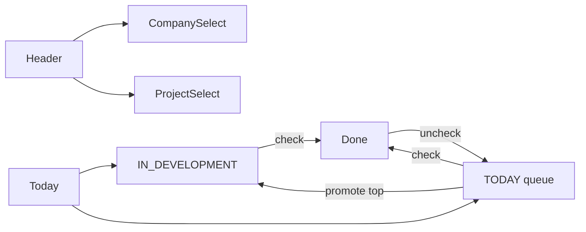

# Artefact Canvas — Scaffold + Dashboard

## Contexto

Nova ferramenta de gerenciamento de projetos (**Artefact Canvas**, slug `ArtefactCanvas`). Stack e ritual iguais ao [TimeToThink](/home/ribeiro/Projects/code/TimeToThink): monorepo `backend/` + `frontend/`, Express + Prisma + PostgreSQL, React + Vite + Tailwind, glass escuro (`--ac-*` / Manrope), sem auth no v1. Workflow: repo em `https://github.com/ribahh-4738-code/ArtefactCanvas.git`; **não** commit/tag/push até você testar; atualizar `README` + `CHANGELOG`; planos em `MDs/`.

Portas (evitar colisão com TTT): API **3089**, Vite **5175**, Postgres host **5435** (`artefactcanvas-db`).

## Escopo v1

- Dashboard do projeto ativo (layout do mockup + identidade TTT).
- Sem página inicial de listagem; navegação via header.
- Seed: 1 empresa + 1 projeto (dados do mockup) para bootstrap.

## Modelo de dados (Prisma)

```
Company  → Project[]
Project  → Task[], Instruction?  (+ artefato, iniciativa, aposta)
Task     → status (IN_DEVELOPMENT | TODAY | DONE), sortOrder, completedAt?, title
Instruction → title, body (1:1 com Project)
```

Regras de negócio:

- **Uma** tarefa `IN_DEVELOPMENT` por projeto (topo de Today, tipografia maior).
- Fila `TODAY` ordenável com ↑/↓; ↑ no primeiro da fila promove para `IN_DEVELOPMENT` (a anterior desce para a fila).
- Checkbox em Today/InDev → `DONE` (agrupa por `completedAt` date).
- Checkbox em Done → volta para `TODAY` (fim da fila).
- `+` em Today cria `TODAY`; `+` em Done/data cria já `DONE` naquela data.
- Instructions: edit in place (duplo clique) no título e corpo.

## API (rotas separadas)

Montagem no estilo TTT (`routes/` finos + Zod → `services/` → Prisma):

- `GET /api/health`
- `/api/companies` — list, create, patch
- `/api/projects` — list by company, create, patch (metadados + last-opened)
- `/api/projects/:id/dashboard` — payload agregado (company, project, tasks, instruction)
- `/api/tasks` — create, patch (title/status/complete), reorder/promote
- `/api/instructions` — upsert por project

Persistir “último projeto” no backend (`Project.lastOpenedAt` ou preferência simples) e abrir sempre nele; fallback no seed.

## Frontend

Espelhar estrutura TTT (`api.ts`, tokens em `index.css`, componentes glass):

- **Header**: `+` empresa (esquerda do nome) | nome empresa (clique → lista) … nome projeto (clique → projetos da empresa) | `+` projeto (direita).
- Metadados Artefato / Iniciativa / Aposta (editáveis ou só leitura no v1 se preferirmos mínimo — **edit in place** alinhado ao mockup).
- Secções **Today**, **Instructions**, **Done** (grupos por data).
- Sem react-router no v1 (uma tela, como TTT).



## Scaffold operacional

Na pasta vazia `/home/ribeiro/Projects/code/ArtefactCanvas`:

1. `git init`, remote `origin` → GitHub dado; `.gitignore`, `.env.example`, `docker-compose.yml`, `package.json`, `index.sh` / `stop.sh` / `reset.sh`.
2. Backend + frontend + Prisma schema + seed.
3. `README.md`, `CHANGELOG.md` (`[Unreleased]`), `MDs/README.md` + mover este plan para `MDs/artefact_canvas_scaffold.plan.md`.
4. Subir com `./index.sh` para você testar.
5. **Parar** antes de commit/tag/push até sua confirmação.

## Fora deste incremento

- Página inicial de listagem empresas/projetos (próximo passo).
- Auth, multi-usuário, drag-and-drop (setas bastam no v1).
