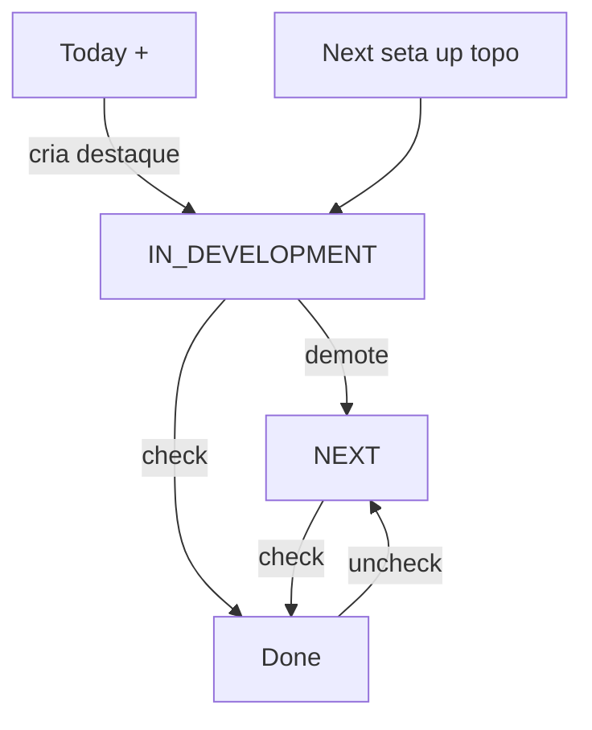

# Today / Next + Instructions por Task

## Decisões fechadas

- `Instruction` deixa de ser 1:1 com Project; vira campo `Task.instructions` (`String`, default `""`).
- Enum `TODAY` renomeia para `NEXT` (fila). `IN_DEVELOPMENT` = único destaque em **Today**.
- Instructions **sempre abertas** só na task de Today. Em Next/Done: ícone Lucide `FileText` à direita do título **quando** `instructions` não vazio; clique expande bloco editável (para não perder o conteúdo ao sair do destaque).
- `+` em Today: input de **uma** linha → nova vira `IN_DEVELOPMENT` e a atual vai para o topo de Next.
- `+` em Next/Done: **textarea**; cada linha não vazia = uma task (`POST` batch).
- Done: controle “data anterior” (`input type="date"`) acima dos grupos; ao confirmar, cria grupo vazio daquela data para inserir concluídas.
- Tipografia fluida via `clamp()` em [`frontend/src/index.css`](frontend/src/index.css) (`html` font-size + tokens de título).

## Backend

**Schema** ([`backend/prisma/schema.prisma`](backend/prisma/schema.prisma)):

- Remover model `Instruction` e relação em `Project`.
- Em `Task`: `instructions String @default("")`; enum `TODAY` → `NEXT`.
- `db push` + ajustar seed: texto do mockup vai na task em destaque; fila com status `NEXT`.

**Services / rotas**

- Remover [`instructionService`](backend/src/services/instructionService.ts), [`routes/instructions`](backend/src/routes/instructions.ts) e mount em [`index.ts`](backend/src/index.ts).
- [`taskService`](backend/src/services/taskService.ts):
  - `createTask`: status default `NEXT`; criar `IN_DEVELOPMENT` demote a atual para `NEXT` (topo).
  - `createTasksBatch(projectId, titles[], { status, completedOn? })`.
  - `updateTask`: aceitar `title` e `instructions`.
  - Renomear moves da fila `TODAY` → `NEXT` (mensagens/filtros).
- [`projectService.getDashboard`](backend/src/services/projectService.ts): payload `tasks: { inDevelopment, next, done }`; sem `instruction` de projeto.
- Rotas: `POST /api/tasks/batch`; patch de task com `instructions`; dropar `/api/instructions`.

## Frontend

- Tipos/API: `Task.instructions`; `createTasksBatch`; remover `upsertInstruction`.
- Layout em [`App.tsx`](frontend/src/App.tsx):
  1. **Today** — só destaque + Instructions abertas + `+` single-line
  2. **Next** — fila ↑/↓ (↑ no 1º promove) + `+` textarea em lote
  3. **Done** — grupos por data + `+` textarea + campo “adicionar data”
- Componentes: fatiar/renomear `TodaySection` → Today + `NextSection`; atualizar `DoneSection`; fundir lógica de [`InstructionsSection`](frontend/src/components/InstructionsSection.tsx) no bloco da task.
- Título editável (duplo clique / input in-place) em Today, Next e Done.
- CSS: `font-size: clamp(15px, 0.85rem + 0.35vw, 18px)` no `html`; títulos com `clamp` maiores.

## Docs / ritual

- Atualizar [`README.md`](README.md) e [`CHANGELOG.md`](CHANGELOG.md) (`[Unreleased]`).
- Salvar plan em `MDs/today_next_task_instructions.plan.md`.
- Subir com `./index.sh` para você testar; **sem** commit/tag/push até sua confirmação.
